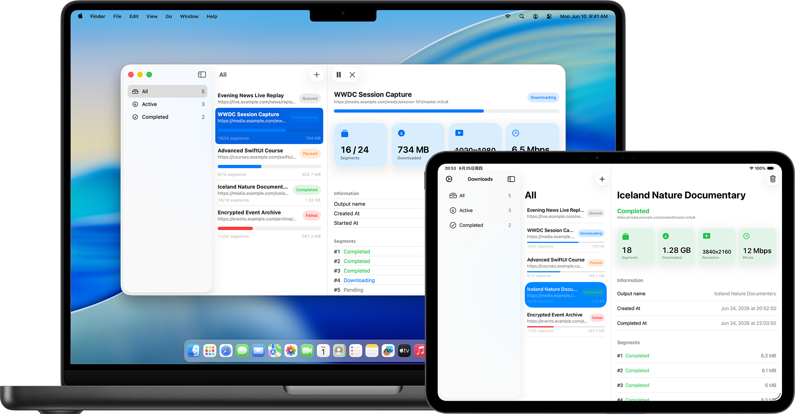

# M3U8 Downloader

   

[简体中文](README.md) | English

M3U8 Downloader is a fully native cross-platform HLS downloader built with SwiftUI. It lets you add `.m3u8` links on macOS and iOS, download media segments, track progress, and play downloaded local media files.



## Highlights

- Fully native Apple platform app with a system-consistent interface and experience
- No third-party libraries, keeping dependencies clear and controllable
- Only 3.5 MB, lightweight and direct

## Features

- Parses M3U8 master playlists and variant playlists
- Downloads TS segments concurrently, with pause, resume, retry, cancel, and delete support
- Supports AES-128 encrypted segments and byte-range segment downloads
- Assembles downloaded media into a local MP4 file
- Shows task status, segment progress, downloaded size, creation time, and completion time in the detail view
- Plays downloaded media locally
- Provides settings for download concurrency, retry count, and timeout
- Supports HTTP, HTTPS, and SOCKS proxies
- Simplified Chinese and English localization
- Dark mode

## Runtime Requirements

- iOS / iPadOS 18.0 or later
- macOS 26.0 or later

## Development

### Requirements

- Xcode 26 or later
- Swift 6 or later
- iOS / iPadOS / macOS SDKs

### Tech Stack

- SwiftUI
- SwiftData
- Swift Observation (`@Observable`)
- Swift Concurrency (`async` / `await`)
- URLSession
- AVKit

The project is built entirely on Apple native frameworks and does not use any third-party libraries.

### Demo Mode

The project includes an `M3U8 Downloader Demo` scheme that loads in-memory sample download tasks for previewing the list, detail view, and status states. Demo mode can also be enabled with a launch argument or environment variable:

```sh
--demo-mode
```

```sh
M3U8_DOWNLOADER_DEMO_MODE=1
```

### Project Structure

```text
M3U8 Downloader/
├── Models/        SwiftData models for download jobs and segments
├── Services/      HLS parsing, segment download, assembly, storage and playback services
├── Settings/      Download, proxy and persistent settings
├── Utilities/     Shared helpers for paths, keychain, security scope and demo launch mode
└── Views/         SwiftUI views for list, detail, settings and download actions
```
