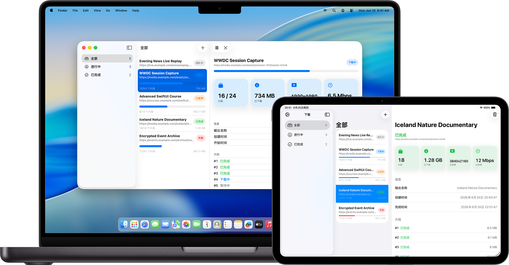

# VideoSniffer

   

简体中文 | [English](README.en.md)

个人自用的 iOS 应用：**内置浏览器 + 网页视频嗅探 + 下载管理**。不需要上架 App Store，通过自由签名（Sideloadly）装到自己的 iPhone 上。

> **当前状态（2026-11-09）**：上游 [LSX-s-Software/M3U8-Downloader](https://github.com/LSX-s-Software/M3U8-Downloader) 的 HLS 下载引擎已原样导入；**内置浏览器（WKWebView + 浏览 / 下载双 Tab）与视频嗅探（JS 注入 + 消息回传）已实现，但尚未通过 CI 编译验证，也未在真机上实测**。工程清理与 GitHub Actions 工作流已就位。详细的开发交接说明（架构、缺口清单、CI、验收标准）见 [Docs/HANDOFF.md](Docs/HANDOFF.md)。



## 产品目标

1. **浏览网页**：在 App 内输入网址访问站点，支持前进 / 后退 / 刷新。
2. **嗅探视频**：自动识别页面播放请求中的 HLS（`.m3u8`）与渐进式媒体（`.mp4` / `.m4s`），列出候选并给出分辨率 / 码率提示。
3. **下载管理**：并发分片下载、暂停 / 继续 / 重试 / 取消 / 删除，进度与磁盘占用可见，下载完成后可在 App 内播放。
4. **自签名装机**：由 CI 产出未签名 IPA，在 Windows 上用 Sideloadly + 免费 Apple ID 安装。

## 功能现状

| 模块 | 状态 | 说明 |
| --- | :---: | --- |
| HLS 解析（主 / 变体列表、AES-128、EXT-X-MAP、BYTERANGE） | ✅ | 来自上游 |
| 分片并发下载、重试、暂停 / 继续 / 取消 | ✅ | 来自上游 |
| 下载组装（TS / fMP4 → 本地可播放文件）与本地 HLS 播放服务 | ✅ | 来自上游 |
| 下载管理界面（列表 / 详情 / 设置 / 存储占用） | ✅ | 来自上游 |
| SwiftData 任务模型与持久化 | ✅ | 来自上游 |
| 简体中文 / 英文、深色模式 | ✅ | 来自上游 |
| 内置浏览器（WKWebView） | 🟡 | 已实现，未经 CI 验证 |
| 视频嗅探（JS 注入 + 消息回传） | 🟡 | 已实现（HLS 可直接加入下载，MP4 仅列出），未经 CI 验证 |
| Referer / Cookie / User-Agent 透传 | ⬜ | 待开发，防盗链站点需要 |
| 直接下载 MP4（不走 HLS 分片） | ⬜ | 待开发 |
| 工程清理（签名团队、Bundle ID、ATS、显示名） | ✅ | Bundle ID `com.videosniffer.app`，显示名 VideoSniffer |
| GitHub Actions 产出未签名 IPA | 🟡 | 工作流已提交，尚未跑过 |

## 环境要求

- **运行**：iOS 26.0 或更新版本（目标机已确认）
- **构建**：不需要本地 Mac。GitHub Actions 的 macOS runner 即可产出未签名 IPA；有 Mac 时也可用 Xcode 26
- **依赖**：零第三方库，只使用 Apple 原生框架（SwiftUI / SwiftData / WebKit / AVKit / Network / CommonCrypto）

## 构建（无 Mac）

构建完全交给 GitHub Actions。当前仓库为 **public**，Actions 额度免费。[.github/workflows/build.yml](.github/workflows/build.yml) 在 `push` 到 `main`、每个 PR 以及手动 `workflow_dispatch` 时构建无签名 IPA，核心步骤：

```sh
xcodebuild \
  -scheme "M3U8 Downloader" \
  -destination 'generic/platform=iOS' \
  -configuration Release \
  -derivedDataPath build \
  CODE_SIGNING_ALLOWED=NO CODE_SIGNING_REQUIRED=NO CODE_SIGN_IDENTITY=""

mkdir -p Payload
cp -R "build/Build/Products/Release-iphoneos/M3U8 Downloader.app" Payload/
ditto -c -k --sequesterRsrc --keepParent Payload VideoSniffer-unsigned.ipa
```

产物 `VideoSniffer-unsigned.ipa` 作为 artifact 上传，在 Actions 运行页下载。

> 注意：必须显式指定 `-destination 'generic/platform=iOS'`。工程同时支持 macOS，不指定 destination 时 `xcodebuild` 可能选到 macOS 平台。

## 安装到 iPhone（Windows + Sideloadly）

1. 安装 **Sideloadly**（<https://sideloadly.io>）。
2. 安装苹果官网版本的 **iTunes** 与 **iCloud**（不要用 Microsoft Store 版本），Sideloadly 依赖其中的驱动。
3. iPhone 上打开 **设置 → 隐私与安全性 → 开发者模式**，重启设备。
4. 用一条**一次性的 Apple ID** 登录 Sideloadly（免费账号签名有效期 7 天，最多同时安装 3 个 App）。
5. 把 IPA 拖入 Sideloadly，填入 Apple ID，点击 Start。
6. 首次打开 App 前，在 **设置 → 通用 → VPN 与设备管理** 中信任对应的开发者证书。

如果 7 天后需要继续使用，重新签名安装一次即可（下载记录保存在 App 沙盒内，覆盖安装通常会保留；若 Sideloadly 提示卸载，请先导出已下载文件）。

## 项目结构

```text
VideoSniffer/
├── M3U8 Downloader/                 # App target（目录名沿用上游，暂未改名）
│   ├── Browser/                     # 内置浏览器：WKWebView、地址栏、嗅探脚本与消息处理
│   ├── Models/                      # SwiftData：DownloadJob / DownloadSegment 等
│   ├── Services/                    # HLS 解析、分片下载、AES-128、组装、本地播放服务
│   ├── Settings/                    # 并发 / 重试 / 超时 / 代理设置
│   ├── Utilities/                   # 路径、Keychain、启动参数、示例数据等
│   ├── Views/                       # 下载列表、详情、设置、播放器等
│   ├── ContentView.swift            # 根视图：iOS 为 浏览 / 下载 两个 Tab
│   ├── M3U8_DownloaderApp.swift     # @main 入口
│   └── Localizable.xcstrings        # 中英文文案
├── .github/workflows/build.yml      # CI：构建无签名 IPA 并上传 artifact
├── M3U8 DownloaderTests/            # 单元测试（HLS 解析、文件存储、删除、设置、嗅探数据校验等）
├── M3U8 DownloaderUITests/          # UI 测试（切到下载 Tab 后打开设置面板）
├── M3U8 Downloader.xcodeproj/       # objectVersion 77，源码目录自动同步，新增 .swift 无需改工程文件
├── Docs/                            # 截图与文档
├── iOS-Info.plist                   # iOS 专用 Info.plist（含 ATS 配置）
├── AGENTS.md                        # 代码风格与协作约定（务必遵守）
└── LICENSE                          # 上游 MIT 许可证
```

## 开发说明

- **Demo Mode**：启动参数 `--demo-mode`，或环境变量 `M3U8_DOWNLOADER_DEMO_MODE=1`，可加载内存中的示例下载任务。
- **本地化**：新增文案写入 `Localizable.xcstrings`，使用 `extractionState: manual` 的符号 key，同时提供 `en` 与 `zh-Hans`。
- **代码风格**：见 [AGENTS.md](AGENTS.md)。要点：Swift 6 并发、`@Observable` + `@MainActor`、不使用 `ObservableObject` / `DispatchQueue`、一个文件一个类型、避免强制解包、避免第三方框架。

## 约束与合规（重要）

- 本项目**仅供个人使用**，**不上架 App Store**，不用于分发。
- 仅处理**非 DRM** 内容与 HLS 明文密钥（AES-128）；**不绕过 FairPlay / Widevine 等任何 DRM**。
- 不得沿用上游的签名团队（`C2A3XCXCZS`）与 Bundle ID（`LSX-s-Software.*`），必须替换为自己的。
- 仓库中**不存放任何密钥、证书、Apple ID 或密码**。
- 下载内容的版权与目标站点的服务条款由使用者自行承担。

## 上游与许可证

本项目基于 [LSX-s-Software/M3U8-Downloader](https://github.com/LSX-s-Software/M3U8-Downloader) 二次开发，原项目以 MIT 许可证发布：

```text
MIT License

Copyright (c) 2026 LSX-s-Software
```

完整许可证见 [LICENSE](LICENSE)。上游代码与界面截图（`Docs/demo.png`、`Docs/demo.en.png`）均保留原署名与版权声明。
